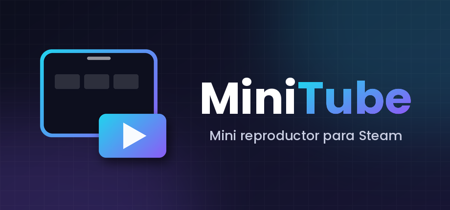

# MiniTube (ytmini) — YouTube TV dentro de Steam

🇬🇧 [English](README.md) · 🇪🇸 Español

Un mini reproductor de YouTube para consolas portátiles con **Steam Big Picture + Decky Loader** (probado en Bazzite, ROG Ally, gamescope, solo táctil y mando). Abre YouTube TV (Leanback, `https://www.youtube.com/tv`) en una vista propia de Steam y la puede dejar **flotando sobre un juego**, con música o video, sin cerrar nada.

<p align="center"></p>

> Proyecto personal, no afiliado a YouTube, Google ni Valve. «YouTube» es marca de sus propietarios; aquí solo se usa para describir con qué sitio funciona.

---

## 1. Qué hace

| Estado | Qué es | Cómo se llega |
|---|---|---|
| **Completa** | Ocupa toda la pantalla | `./launcher.sh fs`, o `"modal": "completo"` en `ytmini.json` |
| **Normal** | Ventana grande tipo modal (84 % del alto) | Por defecto al abrir |
| **Mini video** | Tarjeta pequeña con el video, arrastrable, visible sobre los juegos | Botón *mini* o `./launcher.sh mini` (usa `mini_modo`, por defecto `video`) |
| **Mini audio** | Barra delgada (solo controles; el video baja a la calidad mínima) | Deslizar hacia abajo mientras suena algo (queda guardado como `mini_modo: "bar"`) |
| **Píldora** | Botón diminuto de 60×34 px para volver cuando se minimiza sin nada sonando | Automático al deslizar hacia abajo sin reproducción |

Extras: volumen separado de **YouTube** y del **juego** (vía `pactl`), desplazamiento suave cuando se abre el menú rápido (QAM) de Steam, calidad de video reducida en las formas mini para aligerar el juego, y una ventana de «modo control» tras cerrar el QAM para mover la tarjeta con mando sin quitárselo al juego para siempre.

## 2. Gestos y controles

- **Minimizar:** deslizar un dedo hacia abajo desde la franja superior del video (≈120 px), o **dos dedos hacia abajo en cualquier punto** del video, o arrastrar hacia abajo desde el marco exterior (≥36 px).
- **Tocar fuera** del recuadro no minimiza.
- **Tarjeta mini:** arrastrar por el marco para moverla a otra esquina; tocar el botón de ampliar para volver.
- **Modo mover** (tras cerrar el QAM, unos 7 s, con aro azul): A = play/pausa, B = salir, cruceta = cambiar de esquina, L2/R2 = tamaño, y **arrastrar con el dedo desde cualquier punto de la tarjeta** (el video se oculta mientras dura el modo). Los botones Steam y QAM siguen funcionando.
- **Scroll de Leanback con el dedo:** las filas horizontales se arreglan al tocar para que el arrastre llegue a la lista principal (`fix_filas`).

> Estado de verificación de cada gesto: ver `docs/FICHA_TECNICA.md` §8. Lo del modo control sobre un juego real **aún no está probado**.

## 3. Requisitos

- Steam en **Big Picture / Game Mode** con **Decky Loader** (se usa su `DFL` para crear la vista y los componentes).
- Modo desarrollador de Steam (CEF depurable en `http://localhost:8080`).
- Python ≥ 3.9 y `websocket-client` (los instala `install.sh`).
- `pactl` (PipeWire/PulseAudio) para el volumen del juego.
- Conexión a internet con acceso a `youtube.com`.

## 4. Instalación

```bash
# 1. Copia la carpeta (p. ej. a ~/Games/steam-ytmini) y entra
cd ~/Games/steam-ytmini

# 2. Entorno + dependencias + acceso directo del escritorio (se puede repetir)
./install.sh

# 3. (Opcional) si vienes de versiones antiguas: ver qué se movería y aplicarlo
tools/migrar.sh
tools/migrar.sh --aplicar

# 4. Diagnóstico
./launcher.sh doctor
```

Si ya tenías `ytmini.json`, se conserva (el paquete solo trae `ytmini.json.example`).

### Añadirlo a Steam como acceso directo (con logo)

1. En **modo escritorio**, Steam → *Juegos* → **Añadir un juego que no es de Steam** → *Examinar* → elige `launcher.sh` (en el selector, muestra todos los archivos). Nómbralo **MiniTube**.
2. **Imagen principal (cartel):** en la biblioteca, clic derecho sobre MiniTube → **Gestionar → Establecer arte personalizado** → `assets/capsule_portrait_600x900.png`.
3. **Fondo y logo:** abre la página del juego, haz clic derecho sobre la franja negra de arriba y elige **Establecer fondo personalizado** (`hero_1920x620.png`) o **Establecer logo personalizado** (`logo_1280x720.png`, con transparencia).
4. **Icono:** *Propiedades* del acceso directo → clic en el cuadro del icono junto al nombre → `assets/icon_512.png`.
5. Cierra Steam o vuelve a Game Mode: el arte se ve en la biblioteca, sección *No Steam*. Si no aparece, repite el paso o juega otro juego un momento (así lo describe [esta guía](https://primagames.com/tips/how-to-add-custom-artwork-to-games-on-steam-deck)).

   | Pide Steam | Archivo de `assets/` |
   |---|---|
   | Cartel vertical (imagen principal) | `capsule_portrait_600x900.png` |
   | Cápsula horizontal | `capsule_wide_920x430.png` (y `header_460x215.png`) |
   | Fondo (hero) | `hero_1920x620.png` |
   | Logo (transparente) | `logo_1280x720.png` |
   | Icono | `icon_512.png` o `icon.ico` |

6. En *Propiedades* puedes dejar «Iniciar desde» y las opciones de inicio vacías.

Un toque en el acceso directo = **abrir/cerrar** (`toggle`). El demonio se lanza fuera del árbol de procesos del atajo, para que Steam no marque «jugando» de forma permanente.

Para regenerar o cambiar el arte: `python tools/make_assets.py` (necesita Pillow; usa Poppins si existe).

## 5. Uso diario

`./launcher.sh <orden>`

| Orden | Hace |
|---|---|
| *(ninguna)* / `toggle` | Abre o cierra |
| `open` / `close` | Abrir / cerrar |
| `mini` / `unmini` | Tarjeta pequeña / tamaño normal |
| `pp` | Play/pausa |
| `fs` | Pantalla completa |
| `vol juego\|youtube\|general [N\|+N\|-N]` | Volumen (porcentaje, absoluto o relativo) |
| `escribir <texto>` | Escribe en el buscador de Leanback |
| `teclado` | Teclado en pantalla (experimental) |
| `recargar` | Relee `ytmini.json` |
| `nivel1` / `nivel2` | Mini sobre juegos: solo dibuja / acepta toques y mando |
| `calidad [auto\|fit\|tiny\|small\|medium\|large\|hd720\|hd1080]` | Consulta o fuerza la calidad (`fit` = la más alta que cabe en la vista) |
| `status` / `stop` / `logs` | Estado / detener todo / ver el log |
| `run` | Demonio en primer plano con consola (**Ctrl+C** para salir) |
| `doctor` | Revisa dependencias, JSON, Steam, demonio y red |
| `kill` | Elimina procesos viejos del demonio |
| `install` / `version` / `help` | Instalar / versión / ayuda |
| `diag geo trace azul eventos perf …` | Diagnóstico (ver la ficha técnica) |

## 6. Configuración (`ytmini.json`)

Se lee al arrancar y con `./launcher.sh recargar`. Si el archivo no es JSON válido se usan los valores por defecto y el log lo avisa (`ytmini.json ilegible…`). Decimales **con punto**, sin comas finales.

| Clave | Por defecto | Efecto |
|---|---|---|
| `adblock` | `true` | Quita bloques de anuncios de las respuestas de YouTube TV |
| `ocultar_shorts` | `false` | Oculta la fila de Shorts |
| `sin_pausa_inactividad` | `true` | Evita el aviso «¿sigues ahí?» |
| `ocultar_barras` | `true` | Oculta barras de scroll nativas |
| `zoom` | `1.0` | Escala CSS de la página (Leanback ya se adapta al tamaño; casi no hace falta) |
| `bloqueo_red` | `false` | Bloquea dominios de anuncios con `Fetch` |
| `modal` | `"normal"` | `"normal"` o `"completo"` |
| `botones` | `"pagina"` | Controles dentro de la página (`"pagina"`) o de Steam (`"steam"`) |
| `mini_modo` | `"video"` | `"video"` o `"bar"` al minimizar |
| `mini_esquina` | `"abajo-derecha"` | `abajo/arriba` + `derecha/izquierda` |
| `mini_ancho` | `420` | Ancho de la tarjeta mini en px |
| `mini_margen` / `mini_margen_inferior` | `16` / `64` | Márgenes de la tarjeta |
| `mini_nivel` | `1` | `1` = solo dibuja (toque y mando van al juego); `2` = acepta toques y toma el mando |
| `mini_calidad` | `"medium"` | Calidad en mini video (la barra usa `tiny`); `"auto"` no la toca |
| `ventana_calidad` | `"ajustada"` | Calidad al volver a ventana normal o pantalla completa: `"ajustada"` = la más alta que cabe en la vista (≈720p normal, 1080p completa); `"auto"` = decide YouTube (la v48 se quedaba baja); o un nivel fijo (`"hd720"`, `"hd1080"`…) |
| `mini_mover_tactil` | `true` | En el modo mover (tras cerrar el QAM) el video se oculta unos segundos para poder arrastrar la tarjeta entera con el dedo |
| `fix_filas` | `true` | Corrige el «mini scroll» al arrastrar sobre una fila |
| `cdp_network` | `false` | Activa `Network.enable` (nada lo usa; solo para pruebas de rendimiento) |
| `fetch_solo_documento` | `false` | Experimental: reescribir User-Agent solo en peticiones Document |

## 7. Solución de problemas

| Síntoma | Causa probable | Qué hacer |
|---|---|---|
| `Address already in use` al hacer `run` | Un demonio viejo sigue vivo (típico tras **Ctrl+Z**, que suspende pero no cierra) | `./launcher.sh kill` y vuelve a `run`. Para salir usa **Ctrl+C** |
| `stop` no imprime nada | Mismo caso: el proceso no atiende | `./launcher.sh kill` |
| Log: `ytmini.json ilegible… line N` | JSON roto (coma decimal `0,9`, coma sobrante, comillas) | `python3 -m json.tool ytmini.json` señala la línea |
| «esperando a Leanback… (8 nodos)» y la vista dice **error code -7** | Timeout de red al cargar `youtube.com/tv` | `./launcher.sh doctor`. Si `curl` funciona y la vista no, reinicia el sistema (resolvió un caso real) |
| `doctor`: CEF no responde en :8080 | Steam no está en Big Picture o sin modo desarrollador | Abre Big Picture y activa el modo desarrollador |
| La tarjeta mini no aparece sobre el juego | Nivel de composición | `./launcher.sh nivel2`, o revisa `geo` |
| El arrastre sobre una fila hace scroll solo de la fila | Contenedores `yt-virtual-list` con desborde propio | Debe arreglarlo `fix_filas`; `./launcher.sh diag` lista en `rowfix` lo tocado |
| Tirones del juego con mini video | Decodificación de video | `mini_modo: "bar"`, o `calidad tiny`; mide con `perf` |

**Nunca** borres cookies ni el almacenamiento de `youtube.com` para «arreglar» algo: cierra tu sesión de YouTube y MiniTube no lo necesita.

## 8. Estructura del proyecto

```
steam-ytmini/
├── launcher.sh            lanzador (atajo de Steam, terminal, doctor, kill…)
├── install.sh             entorno + dependencias + acceso directo del escritorio
├── ytmini_tv.py           atajo de compatibilidad -> ytmini.main
├── ytmini.json            tu configuración (no se sobrescribe)  ·  ytmini.json.example = plantilla
├── requirements.txt
├── ytmini/                código
│   ├── config.py          constantes, ytmini.json, User-Agent de TV
│   ├── core.py            estado compartido (S, CFGV, cola, cerrojo, log)
│   ├── cdp.py             cliente CDP, Fetch (User-Agent), pestañas
│   ├── steam.py           vista nativa, Decky, adjuntar página, modo de controles
│   ├── audio.py           volumen YouTube / juego
│   ├── metrics.py         perf (CPU/GPU/vatios)
│   ├── commands.py        do(): todas las órdenes + cola + sondeos + vigilante
│   ├── server.py          servidor local, consola, demonio, cliente
│   ├── main.py            punto de entrada
│   ├── js.py              carga de las plantillas JS
│   └── js/                JS inyectado: page.js (YouTube), modal.js, mini.js y diagnósticos
├── assets/                logo e imágenes de Steam
├── tools/                 make_assets.py (arte), migrar.sh (ordenar versiones viejas)
└── docs/FICHA_TECNICA.md  cómo funciona y qué está verificado
```

Para tocar la interfaz inyectada edita `ytmini/js/*.js` (son el texto exacto que se envía a Steam/YouTube) y `./launcher.sh stop && ./launcher.sh run`.

## 9. Seguridad y privacidad

- El servidor de órdenes escucha solo en `127.0.0.1:8799`.
- Usa el puerto de depuración del CEF de Steam (`localhost:8080`), que ya está abierto por el modo desarrollador: cualquier proceso local puede usarlo, no solo MiniTube.
- No lee, copia ni borra cookies ni sesión de YouTube. `shot` guarda en `capturas/` capturas de pantalla de la vista y de Steam más un índice: pueden mostrar lo que haya en pantalla, así que revísalas antes de compartirlas.
- Al parar (`stop`) se destruye la vista y se restaura el User-Agent.
- La opción `adblock` y `bloqueo_red` modifican lo que YouTube TV recibe; su uso es responsabilidad tuya respecto a las condiciones del servicio.

## 10. Créditos y licencias

- **VacuumTube** (MIT, © shy): la idea de la flag `enable_touch_support` y de hacer scroll con teclas simuladas; se conserva su aviso.
- **DeckWebBrowser** y **Hooandee** (GPL-3.0): solo ideas (BrowserView + BrowserContainer, composición sobre juegos, `pactl`); sin copiar código.
- **decky-steam-pip** (BSD-3): idea del gancho `AddMinimumCompositionStateRequest`.
- Licencia de este proyecto: [MIT](LICENSE).

## 11. Versión

v49 — calidad ajustada al volver a ventana/pantalla completa y arrastre táctil en el modo mover (v48 fue la reestructuración en paquete, sin cambios de comportamiento). Historial y hallazgos: `docs/FICHA_TECNICA.md`.

## Novedades 0.50

**Cerrar (X)** termina todo: pausa el audio, destruye la vista y detiene el proceso. Para volver, abre otra vez el acceso de Steam.

**Modo escritorio:** si no hay Steam Big Picture / CEF, el lanzador muestra un aviso (ventana kdialog/zenity o notificación) en lugar de fallar en silencio. Probar: `./launcher.sh probar-aviso`.

**Animación de apertura:** tarjeta "MiniTube" con barra animada mientras carga, y splash dentro de la página hasta que aparecen los vídeos.

### Actualizar
No hace falta repetir `install.sh` (solo en la primera instalación o si faltan dependencias).
- Con un zip: copia el zip a la carpeta y ejecuta `./launcher.sh actualizar steam-ytmini-X.zip`. Detiene el demonio, guarda una copia en `respaldos/`, sustituye el código y conserva `ytmini.json`, logs, capturas y `.venv`; solo reinstala dependencias si `requirements.txt` cambió.
- Desde GitHub: `./launcher.sh actualizar` (avisa) y `./launcher.sh actualizar --instalar`.

### Informes de problemas
`./launcher.sh reporte` crea `reportes/informe_*.md` (versión, SO, equipo, Steam, audio, red, `ytmini.json`, registro y último fallo). Oculta usuario, equipo, IPs, tokens y cookies. **No se envía nada**: lo adjuntas tú a un issue (`reporte --abrir` abre la página de issues). Los fallos no controlados se guardan en `crashes/`.

### Shorts / mini
`./launcher.sh pagina` vuelca información de la página (vídeo vertical, estado, foco). `./launcher.sh tecla up|down|left|right|enter|back|pgup|pgdn` envía teclas. En mini con vídeo vertical aparecen botones ▲▼. `"mini_shorts": true` activa el recuadro vertical (experimental).

### Publicar
Ver `docs/PUBLICAR.md`, `CHANGELOG.md` y `tools/release.sh`.

## Novedades 0.50
- **Cerrar (X)** termina todo: pausa el audio, destruye la vista y detiene el proceso. Para volver, abre otra vez el acceso de Steam.
- **Modo escritorio:** el lanzador muestra un aviso (kdialog/zenity/notificación) en lugar de fallar en silencio. Prueba: `./launcher.sh test-notice`.
- **Animación de apertura:** tarjeta con barra animada y splash dentro de la página.
- **Interacción del mini sobre un juego (experimental):** solo se interactúa con él con el QAM abierto; con el QAM abierto, Izquierda desde la columna principal da el foco al mini (cruceta mueve, A pausa, L1/R1 tamaño, B vuelve). Fuera del QAM queda bloqueado (candado).
- **Actualizar:** `./launcher.sh update archivo.zip` (o `update` / `update --install` desde GitHub). No hace falta repetir `install.sh`.
- **Informes:** `./launcher.sh report` crea `reportes/informe_*.md` con datos ocultados (usuario, equipo, IPs, tokens). No se envía nada. Los fallos se guardan en `crashes/`.
- **Shorts:** `./launcher.sh page` y `./launcher.sh key up|down…`; botones ▲▼ en mini con vídeo vertical; `mini_shorts` (experimental).

> Los comandos tienen nombre en inglés (`report`, `update`, `key`, `page`, `type`, `reload`, `quality`, `level1/2`, `keyboard`, `test-notice`); los nombres en español siguen funcionando.

## Requisitos y aviso legal
Steam Deck, ROG Ally o PC con Bazzite/SteamOS en Game Mode con [Decky Loader](https://decky.xyz) y Python 3. No funciona en modo escritorio.
Proyecto **no oficial**, sin relación con Google/YouTube ni Valve. Uso personal en tu propio dispositivo; respeta los términos de YouTube. Sin telemetría. Inspirado en técnicas de [VacuumTube](https://github.com/shy1132/VacuumTube) (MIT). Licencia [MIT](LICENSE). Issues: <https://github.com/pascaltll/miniTube/issues>
