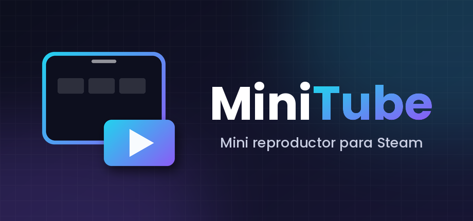

# MiniTube (ytmini) — YouTube TV inside Steam

🇬🇧 English · 🇪🇸 [Español](README.es.md)

A mini YouTube player for handhelds running **Steam Big Picture / Game Mode + Decky Loader** (tested on Bazzite, ROG Ally, gamescope, touch and gamepad only). It opens YouTube TV (Leanback, `https://www.youtube.com/tv`) in its own Steam view and can leave it **floating over a game**, playing music or video, without closing anything.

<p align="center"></p>

> **Beta (0.x).** Unofficial project, not affiliated with or endorsed by Google/YouTube or Valve. "YouTube" and "Steam" are trademarks of their owners.

---

## 1. What it does

| State | What it is | How you get there |
|---|---|---|
| **Full** | Fills the screen | `./launcher.sh fs`, or `"modal": "completo"` in `ytmini.json` |
| **Normal** | Large modal-style window (84 % of the height) | Default on open |
| **Mini video** | Small draggable card with the video, visible over games | *mini* button or `./launcher.sh mini` |
| **Mini audio** | Thin bar (controls only; video drops to minimum quality) | Swipe down while something plays |
| **Pill** | Tiny 60×34 px button to come back when minimized with nothing playing | Automatic |

Extras: separate **YouTube** and **game** volume (via `pactl`), smooth shift when Steam's quick access menu (QAM) opens, reduced video quality in the mini forms to spare the game, and a gamepad "move" focus for the mini card.

## 2. Gestures and controls

- **Minimize:** swipe one finger down from the top strip of the video (≈120 px), or **two fingers down anywhere** on the video, or drag down from the outer frame (≥36 px).
- **Mini card:** drag it by its frame to another corner; tap the expand button to come back.
- **Over a running game (experimental):** the mini only reacts while the QAM is open. With the QAM open, press **Left** from the QAM's main column to focus the mini: D-pad moves it between corners, **A** play/pause, **L1/R1** size, **B** back to the QAM. With the QAM closed it is locked (padlock icon) so touch and gamepad go to the game. With no game running it behaves normally.
- **X / close** in normal mode ends everything: it pauses audio, destroys the view and stops the daemon. Open the Steam shortcut again to come back.
- **Leanback scrolling with a finger:** horizontal rows are patched on touch so the drag reaches the main list (`fix_filas`).

## 3. Requirements

- Steam in **Big Picture / Game Mode** with **Decky Loader** (its `DFL` is used to create the view and components).
- Steam developer mode (debuggable CEF at `http://localhost:8080`).
- Python ≥ 3.9 and `websocket-client` (installed by `install.sh`).
- `pactl` (PipeWire/PulseAudio) for game volume.
- Internet access to `youtube.com`.

It does **not** work in desktop mode: the launcher shows a notice explaining that.

## 4. Install

```bash
# 1. Get the release zip (or clone the repo) and enter the folder
cd ~/Games/steam-ytmini
chmod +x launcher.sh install.sh tools/*.sh

# 2. Environment + dependencies + desktop launcher (safe to repeat)
./install.sh

# 3. Diagnostics
./launcher.sh doctor
```

An existing `ytmini.json` is kept (the package only ships `ytmini.json.example`).

### Add it to Steam as a shortcut (with artwork)

1. In **desktop mode**, Steam → *Games* → **Add a Non-Steam Game** → *Browse* → pick `launcher.sh` (show all files in the picker). Name it **MiniTube**.
2. **Main image (portrait):** in the library right-click MiniTube → **Manage → Set custom artwork** → `assets/capsule_portrait_600x900.png`.
3. **Background and logo:** open the game page, right-click the dark banner and choose **Set Custom Background** (`hero_1920x620.png`) or **Set Custom Logo** (`logo_1280x720.png`, transparent).
4. **Icon:** shortcut *Properties* → click the icon box next to the name → `assets/icon_512.png`.
5. Back in Game Mode the art appears in the library under *Non-Steam*.

| Steam asks for | File in `assets/` |
|---|---|
| Portrait capsule (main image) | `capsule_portrait_600x900.png` |
| Wide capsule | `capsule_wide_920x430.png` (and `header_460x215.png`) |
| Hero (background) | `hero_1920x620.png` |
| Logo (transparent) | `logo_1280x720.png` |
| Icon | `icon_512.png` or `icon.ico` |

One tap on the shortcut = **open/close** (`toggle`). The daemon is started outside the shortcut's process tree, so Steam does not mark it as "playing" forever.

To regenerate the art: `python tools/make_assets.py` (needs Pillow).

## 5. Daily use

`./launcher.sh <command>` — the Spanish names of older versions still work as aliases.

| Command | Does |
|---|---|
| *(none)* / `toggle` | Open or close |
| `open` / `close` | Open / close (close ends playback and stops the daemon) |
| `mini` / `unmini` | Small card / normal size |
| `pp` | Play/pause |
| `fs` | Fullscreen |
| `vol game\|youtube\|general [N\|+N\|-N]` | Volume (absolute or relative percent) |
| `type <text>` | Type into the Leanback search box |
| `keyboard` | Steam's on-screen keyboard (experimental) |
| `reload` | Re-read `ytmini.json` |
| `level1` / `level2` | Mini over games: draw only / accepts touch and gamepad |
| `quality [auto\|fit\|tiny\|small\|medium\|large\|hd720\|hd1080]` | Show or force quality (`fit` = highest that fits the view) |
| `key <up\|down\|left\|right\|enter\|back\|pgup\|pgdn>` | Send a key to YouTube (Shorts/scroll experiments) |
| `page` | Player and page state (Shorts, video size, focus) |
| `status` / `stop` / `logs` | Status / stop everything / show the log |
| `run` | Foreground daemon with console (**Ctrl+C** to quit, never Ctrl+Z) |
| `doctor` | Check dependencies, JSON, Steam, daemon and network |
| `report [--open]` | Write a diagnostic report (see below) |
| `update [file.zip\|--install]` | Apply a zip, or check/install the latest GitHub release |
| `test-notice` | Preview the desktop-mode notice |
| `kill` | Remove stale daemon processes |
| `install` / `version` / `help` | Install / version / help |
| `diag geo trace azul eventos perf …` | Diagnostics (see `docs/FICHA_TECNICA.md`, in Spanish) |

## 6. Configuration (`ytmini.json`)

Read at start-up and with `./launcher.sh reload`. If the file is not valid JSON the defaults are used and the log says so. Decimals **with a dot**, no trailing commas. (Keys keep their original Spanish names for compatibility.)

| Key | Default | Effect |
|---|---|---|
| `adblock` | `true` | Strip ad blocks from YouTube TV responses |
| `ocultar_shorts` | `false` | Hide the Shorts row |
| `sin_pausa_inactividad` | `true` | Avoid the "are you still there?" prompt |
| `ocultar_barras` | `true` | Hide native scrollbars |
| `zoom` | `1.0` | CSS scale of the page (Leanback already adapts; rarely needed) |
| `bloqueo_red` | `false` | Block ad domains with `Fetch` |
| `modal` | `"normal"` | `"normal"` or `"completo"` (full) |
| `botones` | `"pagina"` | Controls inside the page (`"pagina"`) or Steam's (`"steam"`) |
| `mini_modo` | `"video"` | `"video"` or `"bar"` when minimizing |
| `mini_esquina` | `"abajo-derecha"` | `abajo/arriba` (bottom/top) + `derecha/izquierda` (right/left) |
| `mini_ancho` | `420` | Mini card width in px |
| `mini_margen` / `mini_margen_inferior` | `16` / `64` | Card margins |
| `mini_nivel` | `1` | `1` = draw only unless the QAM is open; `2` = always accepts touch and takes the gamepad |
| `mini_calidad` | `"medium"` | Quality in mini video (the bar uses `tiny`); `"auto"` leaves it alone |
| `ventana_calidad` | `"ajustada"` | Quality back in normal/full: `"ajustada"` = highest that fits the view (≈720p normal, 1080p full); `"auto"` = YouTube decides; or a fixed level |
| `mini_mover_tactil` | `true` | While the mini is gamepad-focused, hide the video so the whole card can be dragged by touch |
| `mini_shorts` | `false` | Experimental: vertical card for Shorts in mini |
| `fix_filas` | `true` | Fix the "mini scroll" when dragging over a row |
| `cdp_network` | `false` | Enable `Network.enable` (nothing uses it; only for performance tests) |
| `fetch_solo_documento` | `false` | Experimental: rewrite the User-Agent only on Document requests |

## 7. Updating

`install.sh` is only for the first install (or if dependencies are missing).

- **With a zip:** `./launcher.sh update steam-ytmini-X.zip`. It stops the daemon, backs the code up in `respaldos/`, replaces the code and keeps `ytmini.json`, logs, screenshots and `.venv`. Dependencies are reinstalled only if `requirements.txt` changed.
- **From GitHub:** `./launcher.sh update` (checks) and `./launcher.sh update --install` (downloads, verifies the sha256 and applies the latest release).

## 8. Reporting problems

`./launcher.sh report` writes `reportes/informe_*.md` with: version, OS, device, CPU/RAM, Steam CEF, MiniTube status and config, audio server info, network check, the recent log and the last crash. Username, hostname, home paths, IPs, tokens and cookies are redacted automatically. **Nothing is sent**; review the file and attach it to a [GitHub issue](https://github.com/pascaltll/miniTube/issues/new/choose) yourself (`report --open` opens the issue form). Unhandled errors are also saved in `crashes/`.

## 9. Troubleshooting

| Symptom | Likely cause | What to do |
|---|---|---|
| `Address already in use` on `run` | An old daemon is alive (typical after **Ctrl+Z**) | `./launcher.sh kill`, then `run` again. Quit with **Ctrl+C** |
| `stop` prints nothing | Same case: process not answering | `./launcher.sh kill` |
| Log: unreadable `ytmini.json` | Broken JSON (decimal comma, trailing comma) | `python3 -m json.tool ytmini.json` points to the line |
| "waiting for Leanback… (8 nodes)" and the view says **error code -7** | Network timeout loading `youtube.com/tv` | `./launcher.sh doctor`. If `curl` works but the view does not, reboot (fixed a real case) |
| `doctor`: CEF not answering on :8080 | Steam not in Big Picture / no developer mode | Open Big Picture and enable developer mode |
| The mini card does not show over the game | Composition level | `./launcher.sh level2`, or check `geo` |
| Game stutters with mini video | Video decoding | `mini_modo: "bar"` or `quality tiny`; measure with `perf` |

**Never** clear cookies or `youtube.com` storage to "fix" something: it signs you out of YouTube and MiniTube does not need it.

## 10. Project layout

```
launcher.sh        launcher (Steam shortcut, terminal, doctor, kill…)
install.sh         environment + dependencies + desktop launcher
ytmini/            code: config, core, cdp, steam, audio, metrics, commands, server, report, crash, update, js/
assets/            logo and Steam artwork
tools/             make_assets.py, migrar.sh, empaquetar.sh, release.sh
docs/              FICHA_TECNICA.md (how it works, what is verified; Spanish), PUBLICAR.md
```

To touch the injected UI edit `ytmini/js/*.js` and run `./launcher.sh stop && ./launcher.sh run`.

## 11. Security and privacy

- The command server listens only on `127.0.0.1:8799`.
- It uses Steam's CEF debugging port (`localhost:8080`), already open because of developer mode: any local process can use it, not just MiniTube.
- It does not read, copy or delete YouTube cookies or session. `shot` saves screenshots of the view and Steam into `capturas/`; they can show whatever is on screen, so review them before sharing.
- On `stop` the view is destroyed and the User-Agent restored.
- **No telemetry.** Nothing leaves your device unless you attach a report yourself.
- `adblock` and `bloqueo_red` change what YouTube TV receives; using them is your responsibility regarding the service's terms.

## 12. Credits and license

- **VacuumTube** (MIT): the idea of the `enable_touch_support` flag and of scrolling with simulated keys.
- **DeckWebBrowser** and **Hooandee's Panel de Control** (GPL-3.0): ideas only (BrowserView + BrowserContainer, composition over games, `pactl`); no code copied.
- **decky-steam-pip** (BSD-3): the `AddMinimumCompositionStateRequest` hook idea.
- This project: [MIT](LICENSE).
